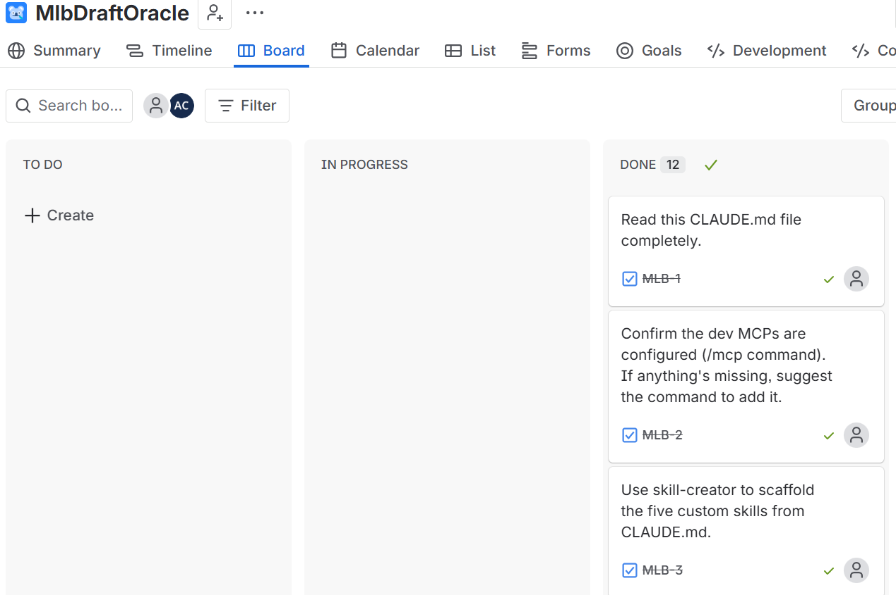
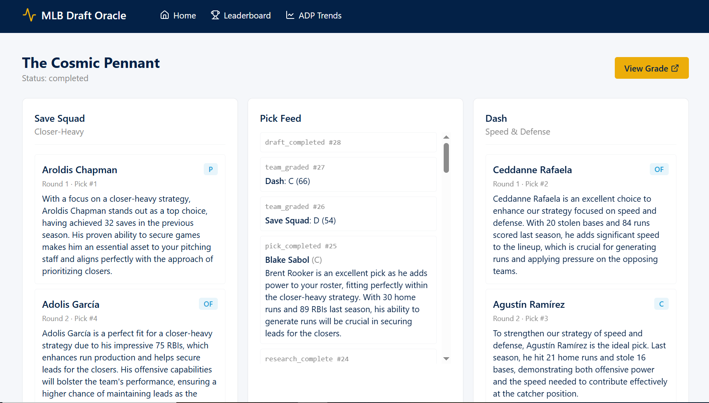
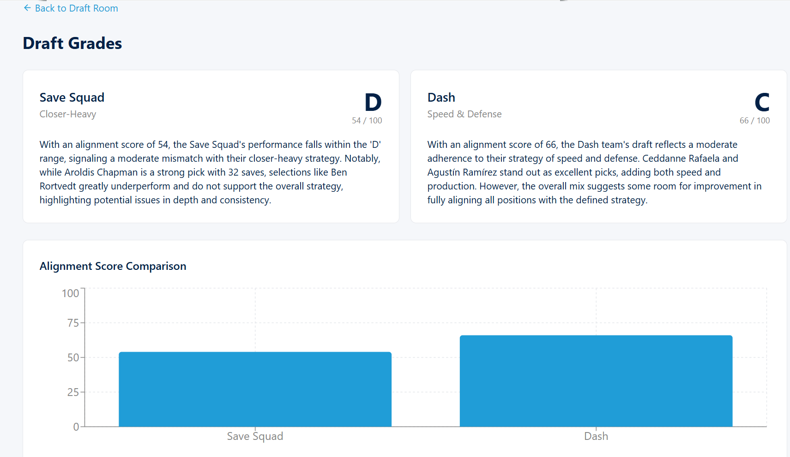

# MLB Draft Oracle

This repository is a demonstration of building a full-stack AI application end-to-end inside Claude Code. Every feature on `main` was implemented ticket by ticket from a Jira board: the **Atlassian MCP** server read each MLB-N ticket from [`https://aacister.atlassian.net`](https://aacister.atlassian.net/jira/software/projects/MLB/boards/34) and transitioned it to Done after merge; the **GitHub MCP** server (with local `git` as fallback) created the feature branch, opened the pull request, and merged to `main`; and `docs/feature_insturctions.md` records the running ledger of completed work. No engineering task on this codebase — reading the spec, writing code, running tests, opening PRs, closing tickets — was performed by hand.

The application itself is an autonomous AI fantasy baseball draft simulator. Two AI-powered teams, each assigned a distinct strategy (Power Hitting vs. Speed & Defense, Ace Pitching vs. Closer-Heavy, etc.), draft against each other and produce written rationales for every pick. A deterministic 0–100 alignment score plus an LLM-narrated letter grade evaluate how well each team executed its strategy.

## Screenshots

### Jira board

The full 12-ticket roadmap delivered through the Atlassian MCP server.



### Draft Room

Two team panels fed live by Server-Sent Events while the AI engine drafts. The center column is the streaming pick feed; the right side shows remaining available players filtered by position.



### Grade

Each team's deterministic alignment score, narrated letter grade, and rationale, with a recharts bar chart comparing the two.



## Technologies

| Layer | Stack |
|---|---|
| Backend | Python 3.12+, FastAPI, OpenAI Agents SDK (`gpt-4o-mini`), Pydantic v2, `uv` |
| Frontend | React 19, Vite 6, Tailwind 4, react-router 7, recharts, lucide-react |
| Database | SQLite + SQLAlchemy 2.x (one file, `Base.metadata.create_all` at boot, no Alembic) |
| RAG / embeddings | `sentence-transformers/all-MiniLM-L6-v2` on CPU (384-dim), JSON files + NumPy cosine similarity, mtime-keyed in-process cache |
| External data | `mlb-statsapi` for the 2025 player pool (cached on disk), `ddgs` (DuckDuckGo) for the Researcher's web tool |
| Streaming / concurrency | Server-Sent Events, `asyncio.create_task` (one Python process, no Celery/RQ) |
| Packaging | Multi-stage Docker image, `docker-compose`, OS-specific start/stop scripts |

## How this was built with Claude Code

The project was developed end-to-end inside Claude Code with MCP servers and a small set of custom skills providing the workflow.

### What `CLAUDE.md` provided

A single living spec file at the repo root pins down everything Claude Code references on every turn:

- **Hard constraints** — Python 3.12+, FastAPI, SQLite, React + Tailwind, runs entirely locally, non-relational state as JSON files under `./memory/`.
- **10 design decisions** — agent framework (OpenAI Agents SDK), LLM (`gpt-4o-mini`), embedding model (`all-MiniLM-L6-v2` local), web search (`ddgs`), MLB stats (`mlb-statsapi`), vector store (JSON + NumPy), streaming (SSE), concurrency (asyncio), frontend toolchain (Vite + React 19 + Tailwind 4), database migrations (`create_all` at boot).
- **Functional requirements** — player pool size and stat shape, six named strategies with explicit stat tags, draft creation/execution flow, agent responsibilities, two-phase grading, ADP trend analysis.
- **Persistence layout** — relational truth in SQLite, snapshots and vectors as JSON files under `./memory/`.
- **API surface** — every `/v1` endpoint the FastAPI app must expose.
- **Coding conventions** — `from __future__ import annotations`, full type hints, Pydantic v2 at boundaries, `ruff`/`eslint`/`prettier`, `pytest` + `vitest`.
- **Dev process** — every feature flows through Jira → feature branch → tests → PR → merge → feature-log entry → CLAUDE.md update.

`docs/decisions.md` is a one-or-two-sentence restatement of every design choice for contributors. `docs/feature_insturctions.md` is the running ledger of completed work.

### Custom skills (authored in MLB-3, used in every subsequent ticket)

Five domain-specific skills were authored under `.claude/skills/` so Claude Code could load the right constraints automatically without re-reading the full spec each turn:

| Skill | What it pins down |
|---|---|
| `domain-vocab` | Draft mechanics, position bucket rules (C / 1B / OF / P), six strategy names with stat tags, fantasy stat categories |
| `sqlite-conventions` | Table naming, UUID v4 string primary keys, JSON columns for variable-shape data, SQLAlchemy 2.x model + function-style repository patterns |
| `agent-prompts` | House style for Researcher / Drafter / Grader: input schemas, Pydantic Structured Outputs, max-turn limits, retry logic |
| `vector-store` | Canonical embedding text recipe, pick/ADP file schemas, cosine-search interface, mtime-keyed cache |
| `local-only` | Constraint checklist that auto-fires when a new dependency or persistence layer is proposed — prevents drift toward managed services |

Built-in skills also used during the build: `feature-dev`, `skill-creator`, `code-review`, `frontend-design`.

### MCP servers used

| Server | Role |
|---|---|
| **Atlassian** | Read each MLB-N ticket from `https://aacister.atlassian.net`; transition the ticket to Done after the PR merged |
| **GitHub** | Create branches, open pull requests, merge to `main` (local `git` as fallback when the MCP session was unavailable) |
| **Filesystem** | Edit files in the repo |
| **SQLite** | Query `./data/mlbdraftoracle.db` during development |

### Per-ticket workflow

1. Read the Jira ticket via the Atlassian MCP.
2. Plan, then implement on a feature branch (`mlb-<N>-<slug>`).
3. Run the full test suite (`uv run pytest` and `npm test`).
4. Open a PR via the GitHub MCP and merge to `main` once green.
5. Append the completed work and design notes to `docs/feature_insturctions.md`.
6. Transition the Jira ticket to Done.

## Feature timeline

Each row corresponds to one Jira issue and one merged PR. See `docs/feature_insturctions.md` for full per-ticket detail.

| Ticket | Outcome |
|---|---|
| MLB-1  | Read `CLAUDE.md`; established project understanding |
| MLB-2  | Verified required MCP servers |
| MLB-3  | Scaffolded five custom Claude Code skills in `.claude/skills/` |
| MLB-4  | Wrote `docs/decisions.md` — single-page summary of design choices |
| MLB-5  | Project scaffold: `pyproject.toml`, `package.json`, `.env.example`, `.mcp.json` |
| MLB-6  | SQLite layer: SQLAlchemy models + function-style repositories + 19 tests |
| MLB-7  | 2025 player-pool ingestion via `mlb-statsapi` with on-disk response cache (414 players) |
| MLB-8  | Vector store (JSON + NumPy cosine), embeddings, deterministic grading algorithm |
| MLB-9  | Researcher, Drafter, Grader agents + snake-draft engine + SSE event log |
| MLB-10 | FastAPI app with all `/v1` endpoints and the streaming endpoint |
| MLB-11 | React frontend: Home, Draft Room, Grade, Leaderboard, ADP Trends |
| MLB-12 | Canonical end-to-end test exercising the full HTTP-to-engine-to-disk flow |
| Follow-up | Docker packaging + single-container deployment + OS-specific start/stop scripts |

## Run it

Prerequisites: Docker Desktop, an OpenAI API key.

```bash
git clone https://github.com/aacister/MLB_Draft_Oracle_Vibe_Claude.git
cd MLB_Draft_Oracle_Vibe_Claude
cp .env.example .env                # add OPENAI_API_KEY
scripts/start-windows.ps1           # or scripts/start-mac.sh / start-linux.sh
```

The container builds on first run, ingests the 2025 player pool (cached afterwards), and serves the full app at **http://localhost:8000**.

Stop with `scripts/stop-windows.ps1` (or the OS equivalent).

## License

See `LICENSE`.
